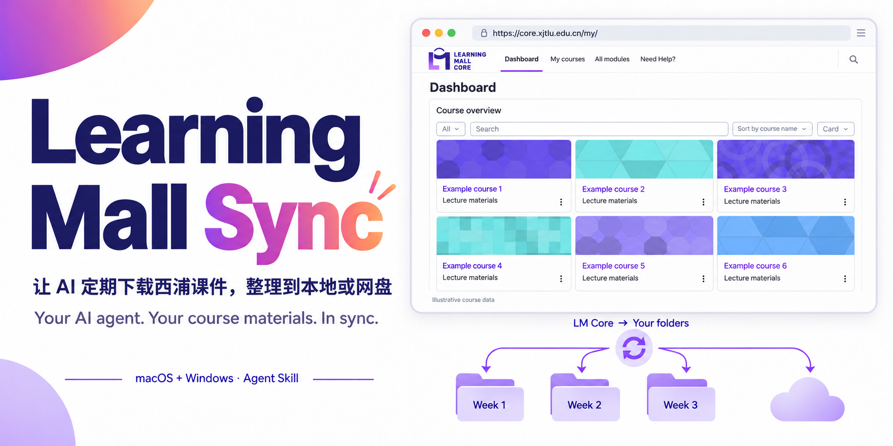

<div align="center">

<b>简体中文</b> · <a href="README.en.md">English</a>



# Learning Mall Sync

**让你的 AI Agent 定期自动下载西浦课件，整理到本地或网盘。**

Let your AI agent automatically download XJTLU course materials on a schedule and organize them locally or in cloud storage.

[](https://github.com/yaobii-lab/learning-mall-sync/actions/workflows/tests.yml) · [MIT](LICENSE) · macOS & Windows

<a href="#quick-start">🚀 快速开始</a> · <a href="#schedule">🗓️ 定时同步</a> · <a href="#storage">📁 保存位置</a> · <a href="https://github.com/yaobii-lab/learning-mall-sync/releases/latest">📦 下载技能包</a>

</div>

把这个 Skill 交给 WorkBuddy、Codex、Muse 等 AI Agent，选好课程、保存位置和同步周期，让它帮你检查更新、下载并整理课件。

## 💬 你说一句，Agent 来整理

> 把我这学期的 Learning Mall 课件同步到 OneDrive，每 2 天检查一次。有新课件或老师替换了文件再告诉我。

第一次，Agent 会带你选课程、连接浏览器、确认保存位置和时间。你在浏览器里完成登录与授权，之后它复用这个浏览器的登录状态，定期下载和整理。

| 🔐 登录一次 | 🗓️ 按时同步 | ☁️ 自选保存位置 |
| --- | --- | --- |
| 后续复用浏览器登录状态 | 每天、每 2 天或每周检查 | 本地文件夹或网盘同步目录 |

发现新增与替换，保留旧版；按课程、周节整理，每门课生成可点击的文件索引。有变化再告诉你。

<details>
<summary>📂 看看整理后的文件夹</summary>

文件夹会是这样（示意）：

```text
LearningMall/
└── ADS205/
    ├── _index.md
    ├── Week 1/
    │   └── Lecture 1.pdf
    └── Week 2/
        ├── Lecture 2.pdf
        └── _旧版/
            └── Lecture 2 (2026-10-21).pdf
```

</details>

<a id="quick-start"></a>

## 🚀 快速开始

### 1. 安装 Skill

把[仓库链接](https://github.com/yaobii-lab/learning-mall-sync)或 [Release 中的技能包](https://github.com/yaobii-lab/learning-mall-sync/releases/latest)交给你的 Agent，请它安装并读取 [SKILL.md](SKILL.md)。支持技能导入的 Agent，也可以在界面里导入技能包。

<details>
<summary>习惯用命令行？展开安装命令</summary>

如果你习惯使用命令行，也可以运行以下命令，选择要安装到的 Agent：

```bash
npx skills add yaobii-lab/learning-mall-sync -g
```

其他安装方式见[手动安装](docs/configuration.md#手动安装)。

</details>

### 2. 把任务交给 Agent

> 帮我同步 Learning Mall 的课件。第一次用，请带我选课程、保存位置和同步周期。

Agent 会检查浏览器工具。需要新装时首推 **CUA Driver**，也可以用 Harness 推荐的 **browser-use**，或 Dot / personal agent 已有的浏览器。[查看浏览器接入说明](references/browser-tools.md)。

### 3. 登录、选课，然后开始

你在浏览器里登录 [Learning Mall Core](https://core.xjtlu.edu.cn/)，授权 Agent 使用这个浏览器。它会列出课程，引导你选择保存位置、作业说明附件、同步周期和通知方式，展示待下载数量与每门课的完整保存路径，再开始归档。

需要 Python 3.10+，以及支持 Skill、运行命令、读写文件和操作浏览器的 Agent。Python 脚本只用标准库。

<a id="schedule"></a>

## 🗓️ 登录与定时同步

**首次登录并授权，后续复用登录状态。** 同步会沿用同一个浏览器环境；学校的单点登录仍有效时，可以自动跳转登录。学校要求重新验证时，Agent 会提醒你在浏览器完成登录。

**周期由你选。** 每天、每 2 天、每周或指定时间都可以。例如：

> 改成每周日晚上 8 点同步，有新课件再通知我。

定时任务由所在 Harness 安排，执行时需要能访问浏览器和保存目录；本机运行时，电脑需要开着。Harness 没有定时能力时，也可以随时说一句“同步课件”手动运行。

<a id="storage"></a>

## 📁 保存到哪里

| 保存方式 | 你会得到什么 |
| --- | --- |
| 电脑上的文件夹 | 默认保存到用户 Documents 下的 `LearningMall`，也可以自选目录或盘符 |
| Google Drive、OneDrive、iCloud Drive、Dropbox | 课件进入网盘同步文件夹后自动上传，在其他电脑、平板或手机上查看 |

网盘同步使用已安装并登录的桌面客户端。Agent 会帮你找到或选择它的本机同步文件夹，并展示完整路径。Dot / personal agent 在远端运行时，也会说明文件保存在那台机器的哪里。

## 💬 常见问题

**会下载哪些内容？** 课件文件和可选的作业说明附件。录播、论坛、成绩和同学提交不在同步范围。

**每次都要重下全部课件吗？** 有修订号且本地文件存在的课件会跳过；作业附件和部分直接下载资源需要重新下载、比较内容，相同内容不会重复保存。

**同步卡住了怎么看？** Agent 会报告具体课程和原因。`partial` 表示还有未完成项，`blocked` 表示需要处理登录等阻塞；[配置文档](docs/configuration.md) 里有查看配置、同步历史和问题记录的方法。

## 🛠️ 开发与反馈

<details>
<summary>运行测试与反馈问题</summary>

macOS / Windows 的 CLI 回归测试使用临时目录和合成文件。进入仓库目录后运行：

```sh
# macOS
python3 -m unittest discover -s tests -v
```

```powershell
# Windows
py -3 -m unittest discover -s tests -v
```

浏览器登录与真实下载请在所用 Harness 中先试一份文件。遇到问题时，欢迎按 [贡献说明](CONTRIBUTING.md) 提供操作系统、Harness、浏览器工具和脱敏报错。

</details>

## 📄 License

[MIT](LICENSE) · 非西交利物浦大学官方项目。课件版权归各自权利人，仅供本人学习，请勿公开上传课件或登录数据。

封面参考 [LM Core 课程概览](https://core.xjtlu.edu.cn/my/)，课程内容已替换为示例数据。界面与标识版权归西交利物浦大学所有。
